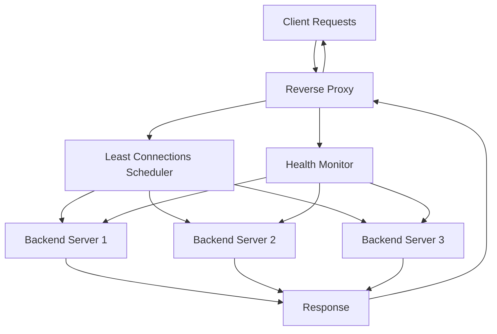

# Intelligent Reverse Proxy & Load Balancer

A custom-built reverse proxy designed to intelligently distribute incoming HTTP traffic across multiple backend servers. It implements **least-connections load balancing**, active health monitoring, and automatic failover to improve service availability, reliability, and traffic distribution.

## Overview

The project explores the internal workings of reverse proxies and load balancers by implementing a system that sits between clients and backend servers.

Instead of allowing clients to communicate directly with individual backend instances, all incoming requests pass through a centralized proxy that selects an appropriate server based on its current connection load and health status.

The system continuously monitors backend availability and handles server failures by routing traffic away from unhealthy instances.

## Key Features

- **Reverse Proxy:** Forwards incoming client requests to backend servers.
- **Least-Connections Load Balancing:** Routes requests to the healthy backend with the fewest active connections.
- **Active Health Checks:** Periodically monitors backend server availability.
- **Automatic Failover:** Excludes unhealthy backend servers from request distribution.
- **Dynamic Backend Management:** Maintains the availability status of registered backend instances.
- **Connection Tracking:** Tracks active connections to support intelligent request distribution.
- **Fault Tolerance:** Maintains service availability when individual backend instances become unavailable.
- **Request Forwarding:** Handles HTTP request and response forwarding between clients and backend servers.

## System Architecture



### Request Lifecycle

1. A client sends an HTTP request to the reverse proxy.
2. The proxy identifies currently healthy backend servers.
3. The load balancer selects a backend using the least-connections strategy.
4. The request is forwarded to the selected backend.
5. The backend processes the request and returns a response.
6. The proxy forwards the response to the original client.
7. Connection tracking is updated.

### Health Monitoring & Failover

The health monitor periodically sends health-check requests to registered backend servers.

- Healthy servers remain eligible for traffic distribution.
- Unresponsive servers are marked unhealthy.
- Unhealthy servers are excluded from backend selection.
- Recovered servers can be reintroduced after successful health checks.

## Load Balancing Strategy

The project uses the **Least Connections Algorithm**.

Unlike round-robin scheduling, which distributes requests sequentially, least-connections routing considers the current number of active connections on each backend.

The backend with the lowest active connection count is selected.

This approach is particularly useful when requests have different processing times and backend workloads are uneven.

## Technology Stack

The technology stack can be updated as implementation progresses.

| Component | Technology |
|---|---|
| Core implementation | To be specified |
| Networking | HTTP / TCP |
| Load balancing | Least Connections |
| Health monitoring | Active Health Checks |
| Testing | Load and failure testing |
| Version control | Git & GitHub |

## Project Structure

```text
intelligent-reverse-proxy/
│
├── src/
│   ├── proxy/
│   ├── load_balancer/
│   ├── health_checker/
│   ├── backend/
│   └── connection_tracker/
│
├── tests/
│   ├── test_proxy/
│   ├── test_load_balancer/
│   └── test_health_checker/
│
├── config/
│   └── config.yaml
│
├── docs/
│   └── architecture.md
│
├── .gitignore
├── README.md
└── LICENSE
```

*The directory structure represents the proposed organization and can be adjusted to match the actual implementation.*

## Getting Started

### Prerequisites

- Git
- Your implementation's runtime and package manager
- One or more backend HTTP servers

### Installation

Clone the repository:

```bash
git clone <YOUR_REPOSITORY_URL>
cd intelligent-reverse-proxy
```

Install dependencies using the package manager associated with your implementation.

### Configuration

Configure the backend servers and health-check settings.

Example configuration:

```yaml
proxy:
  host: 0.0.0.0
  port: 8080

load_balancer:
  strategy: least_connections

health_check:
  enabled: true
  interval: 5
  timeout: 2

backends:
  - url: http://localhost:8001
  - url: http://localhost:8002
  - url: http://localhost:8003
```

*Configuration schema is illustrative and should match the actual implementation.*

## Testing

The project is intended to be evaluated across the following scenarios:

- **Traffic Distribution:** Verify that requests are distributed according to active connection counts.
- **Backend Failure:** Stop a backend instance and verify that it is excluded from routing.
- **Automatic Recovery:** Restart an unhealthy backend and verify that it becomes eligible again.
- **Concurrent Requests:** Evaluate behavior under simultaneous client requests.
- **Load Testing:** Measure throughput and latency under different traffic loads.
- **Fault Tolerance:** Verify that requests continue to reach available backends when one instance fails.

## Performance Evaluation

Performance should be evaluated using measurable metrics:

| Metric | Description |
|---|---|
| Throughput | Requests processed per second |
| p50 Latency | Median request latency |
| p95 Latency | 95th percentile request latency |
| p99 Latency | 99th percentile request latency |
| Failover Time | Time required to detect and exclude a failed backend |
| Backend Distribution | Distribution of traffic across healthy instances |

Benchmark results will be documented after controlled load testing.

## Future Improvements

- Weighted least-connections scheduling.
- Support for multiple proxy protocols.
- Persistent connections and connection pooling.
- Circuit breaker implementation.
- Rate limiting and request throttling.
- TLS termination and HTTPS support.
- Metrics collection and Prometheus integration.
- Grafana-based monitoring dashboard.
- Docker-based deployment and orchestration.

## Learning Objectives

This project explores practical systems engineering concepts, including:

- Reverse proxy architecture.
- Load balancing algorithms.
- Concurrent request handling.
- Network communication and HTTP forwarding.
- Health monitoring and failure detection.
- Fault tolerance and high availability.
- Performance benchmarking and system observability.

## Contributing

Contributions, suggestions, and improvements are welcome. Feel free to fork the repository, experiment with alternative scheduling algorithms, and submit pull requests.

## License

This project is licensed under the MIT License. See the `LICENSE` file for details.
